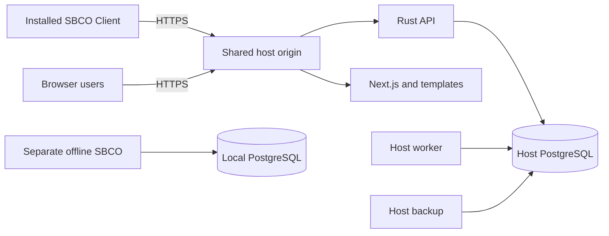

# Connected desktop implementation and Windows qualification

Status: 29 October 2026. Connected HTTPS desktop mode is implemented. The installed Linux client passed real HTTPS acceptance against the isolated Rust API. Windows MSI installation/repair/uninstall, native transport tests, configured server services and scheduled backup/restore passed on hosted Windows Server 2025. Actual Windows desktop GUI and Windows 10/11 office deployment remain separate qualification gates. The default standalone offline application remains available and has passed a new native regression test.

## Deployment choices

| Installation                            | Shared services                                                | Installed client                                           |
| --------------------------------------- | -------------------------------------------------------------- | ---------------------------------------------------------- |
| Linux host with Windows clients         | Rust API, worker, PostgreSQL, Next.js and HTTPS proxy on Linux | SBCO Client with WebView2, using the server's HTTPS origin |
| Windows 10/11 host with Windows clients | The same services on an ordinary Windows desktop computer      | The same SBCO Client, including on the host if required    |
| Independent offline workstation         | Local Rust backend, worker and private PostgreSQL cluster      | Separate standalone SBCO package                           |

The Windows host target is Windows 10/11 desktop editions, not Windows Server. A GitHub-hosted Windows build runner does not establish compatibility with either office desktop edition. The exact Windows edition/build, servicing status and packaged runtime prerequisites remain deployment gates. Standard Windows 10 support ended in October 2025; applicable ESU or LTSC servicing must be established for the selected machine. [Microsoft Windows release information](https://learn.microsoft.com/en-us/windows/release-health/release-information)

There is no synchronization or automatic fallback between shared and offline data. A connected client does not create a PostgreSQL cluster, launch import workers, run migrations or receive database credentials. Server unavailability produces a connection error.

## Implemented transport and identity boundary

`apps/desktop/src-tauri/src/main.rs` selects the connected startup branch only when built with the `connected-client` Cargo feature. That branch initializes `transport::Remote` and omits local database startup, background processing and automatic backups. The default build retains local database/session behavior. The desktop state has optional local and remote adapters; it does not implement the storage-oriented application `Backend` trait over HTTP or accept a caller-supplied remote identity.

`apps/desktop/src-tauri/src/transport.rs` owns reqwest 0.13.5 with platform certificate verification and an in-memory cookie jar. The renderer continues to use typed Tauri IPC and never receives the session cookie. The existing IPC-only content security policy is unchanged. Only fixed API and known template paths are requested under the configured origin; redirects are rejected before another destination can receive a request.

The persisted `server-connection.json` contains only `server_url`. Credentials, cookies and database connection strings are not written there. App restart discards the session. Each sign-in creates a fresh cookie jar, verifies the server compatibility response and then submits credentials. Sign-out attempts server revocation for up to three seconds and clears the local cookie jar even when the server is unavailable.

The connection accepts HTTPS origins only: no embedded credentials, path, query or fragment. The release binary has no HTTP exception. A debug-only environment opt-in can permit exact loopback HTTP addresses for development; the actual native acceptance described below used HTTPS with a trusted test CA instead. There is no certificate-error bypass setting.

Before saving an address and before sending sign-in credentials, the client requires `/api/v1/server-info` to report `application: "SBCO"`, `api_version: 1` and the `training` capability. The endpoint also returns the package version and template capability. This is a coarse API-version/capability check, not a minimum-client-version negotiation system.

All native API calls send `X-SBCO-Request: 1`. Selected training requests also send the frozen `X-SBCO-Training` context for identity, queries, commands and PDF exports. Training lifecycle controls use live authentication. The server remains responsible for session validity, permissions, office scope, revision checks and command receipts. A 401 becomes the native "Sign in to continue" error; no automatic offline fallback or replay queue is introduced.

Connect timeout is ten seconds, request timeout ninety seconds, and responses are limited to 64 MB. Commands retain the explicit request UUID supplied through the existing contract. A general UI that automatically retains an uncertain command's UUID across a manual resubmission is not implemented; operators should inspect current server state before repeating an action whose response was lost.

## Startup and native controls

`packages/features/src/first-run.tsx` adds **Connect to your SBCO server**, a server-address field and **Connect to server**. `connection_status` runs before local setup checks. A configured connected build skips local administrator creation and shows assigned-account sign-in with the saved server address. **Change server** signs out locally, clears persisted training selection and opens the address screen; saving a new connection reloads the page before any old form can operate on it. The frozen workspace selection remains intact for the lifetime of already mounted forms.

Connected builds hide local backup/restore controls. Direct backup/restore IPC is rejected, and backup status reports disabled. The server administrator manages backups. Template saves check the effective remote role, download the known workbook from the same HTTPS origin and use the native Save dialog. PDF exports are generated by the server and use the same native Save dialog, with the existing training filename/marking behavior.

The client currently displays the server address at sign-in and offers **Change server** while signed in. A persistent authenticated office/server label and installer-supplied address provisioning are not implemented.

## Package separation

`apps/desktop/src-tauri/tauri.connected.conf.json` defines **SBCO Client**, identifier `in.sbco.client`, its own application-data namespace and WiX upgrade code `d599863f-574d-46f4-bebf-3609e933a7e1`. The standalone package retains its existing identity. The connected resource list is an array that replaces the base PostgreSQL resource map; archive inspection confirmed no PostgreSQL resources in the built connected Linux installer.

The shared Rust source still compiles local infrastructure and document dependencies. This release separates startup and packaged resources; it does not claim complete compile-time removal of every local backend dependency. Connected computers do not require PostgreSQL, Node.js or Rust build tools at runtime.

Windows scripts and workflows build a separate connected MSI, standalone MSI and server MSI. `scripts/build-connected-client-msi.ps1` supplies the feature/configuration, builds the static frontend first and invokes Tauri. The Windows overlay includes the WebView2 offline installer and separate product branding/upgrade identities. Build the Windows outputs on Windows; Linux package acceptance does not qualify them. [Tauri Windows installer documentation](https://v2.tauri.app/distribute/windows-installer/), [Microsoft WebView2 distribution](https://learn.microsoft.com/en-us/microsoft-edge/webview2/concepts/distribution)

## Executed evidence

- Native Rust transport tests cover origin restrictions, session-cookie forwarding, workspace headers, cookie removal on sign-out, bounded sign-out when the server stops responding, redirect rejection and incompatible-server rejection. Connected and default desktop compilation and strict Clippy checks passed.
- `tests/native_connected.py` ran the installed connected Linux package in a disposable container. A temporary HTTPS proxy targeted only the isolated API on port 8091; its test CA was installed only inside that container. A certificate hostname mismatch was rejected, then a trusted HTTPS address configured successfully.
- That native test signed in with a unique assigned account, enabled training, read and created training offices, reset training, saved the exact delivered setup-template bytes and a server-generated PDF through genuine native dialogs, confirmed server-only backup controls, restarted the application, and verified URL persistence with no retained session or local PostgreSQL files. The temporary account was disabled and its sessions revoked afterward. `tests/connected_https_proxy.py` is the test-only loopback proxy helper.
- Three browser connection cases passed in Chromium, Firefox and WebKit, including validation/retry, configured startup, absence of local setup/backups and changing server from an active training session. The existing standalone setup and Help/training cases also passed: 27 cases total. These browser checks mock IPC; they supplement the installed native test.
- The rebuilt default standalone Linux installer passed `tests/native_desktop.py` with networking disabled: first-run setup, local sign-in, setup import, a 251-row workbook, PA verification/search, onboarding persistence, automatic backup/checksum/private permissions and DPR/MPR reporting.
- Latest local evidence logs are `/tmp/sbco-connected-native-acceptance.log`, `/tmp/sbco-connected-final-check.log` and `/tmp/sbco-connected-offline-regression.log`. Screenshots were visually inspected. These temporary logs are local evidence, not release payloads.

Hosted Windows evidence also includes [server/client installer smoke](https://github.com/sbcohelp-source/sbco/actions/runs/40876179179), [clean standalone installer smoke](https://github.com/sbcohelp-source/sbco/actions/runs/40876658266), [configured server lifecycle](https://github.com/sbcohelp-source/sbco/actions/runs/40883757329) and [SYSTEM backup/restore](https://github.com/sbcohelp-source/sbco/actions/runs/40883720195). These results do not claim that the installed Windows client GUI has completed a real office workflow.

## Remaining Windows and office acceptance gates

1. Generated MSI contents, dependencies, branding and distinct upgrade identities have passed hosted checks. Sign/timestamp accepted releases when the signing identity is available; the current artifacts are unsigned.
2. On clean, supported Windows 10/11 target machines, test connected installation with the bundled WebView2 prerequisite, trusted organizational certificates, startup, server-address persistence and real native Save dialogs. Confirm no database service or database credentials on connected clients.
3. Against both the Linux host and an actual Windows 10/11 host, run complete setup/transaction imports, PA verification, supervisor review, corrections, correspondence and reports from at least two installed clients. Verify role/session revocation, revision conflicts, interrupted uploads and uncertain-response operator recovery.
4. Qualify Windows host service start before login, logoff/reboot survival, clean stop, crash recovery, occupied ports, disk-full behavior and database startup delays. Test the packaged native service wrappers; registering a console binary alone does not establish correct SCM lifecycle handling.
5. Verify host configuration ACLs, loopback-only PostgreSQL/API listeners, HTTPS firewall scope, certificate renewal, daily backup checksum/retention and a full restore rehearsal preserving accounts, audit history and issued PDFs.
6. Test repair, a real next-version upgrade, rollback/recovery and uninstall data retention on Windows. Earlier Linux same-version reinstall tests are not Windows or future-version upgrade evidence.
7. The standalone Windows native PostgreSQL lifecycle and installer smoke pass, including actual initialization, backup, restore and restart using the built-in `C.UTF-8` locale provider. Complete its installed desktop GUI flow and real Windows 10/11 office checks separately.
8. Confirm the chosen office hostname/network, exact OS servicing baseline, operator training and pilot approval. Windows 10/11 host qualification is not replaced by a Windows Server build runner.

No Windows-machine acceptance, signing verification or multi-computer office pilot is claimed by the Linux results. The deployment plan records host packaging and rollout status separately.
