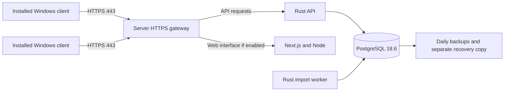

# Server and Windows-client deployment plan

Updated 28 October 2026. The user requests installed Windows clients, with either a Linux server or a Windows 10/11 computer acting as the server. Standalone offline use remains a separate mode. The current local installation uses a fresh database.

## Deployment arrangements

| Arrangement                             | Server components                                                                                          | Windows client components                                             | Database location  |
| --------------------------------------- | ---------------------------------------------------------------------------------------------------------- | --------------------------------------------------------------------- | ------------------ |
| Linux server with Windows clients       | Rust API and worker, PostgreSQL 18.6, Next.js/Node web service, HTTPS reverse proxy, backup service        | Installed Tauri connected client, packaged UI, WebView2               | Server only        |
| Windows 10/11 host with Windows clients | Native Windows services for Rust API/worker, PostgreSQL 18.6, Next.js/Node, HTTPS proxy; scheduled backups | Same connected-client installer and UI                                | Server only        |
| Standalone offline Windows computer     | Local Rust core and PostgreSQL 18.6 launched by the desktop app                                            | Offline Tauri package, WebView2, PostgreSQL binaries and dependencies | That computer only |

The official PostgreSQL version table lists **18.6** as the current stable 18.x release on this date. Pin this patch in tested release packages; review later stable 18.x patches through backup and restart testing before updating. Do not adopt a release candidate or change the major version silently. [PostgreSQL version policy](https://www.postgresql.org/support/versioning/).

Connected clients must use the HTTPS API. Database credentials remain on the server. Do not open PostgreSQL to client PCs or configure a client with the server's `DATABASE_URL`. Server sessions enforce the same PA, supervisor and administrator permissions as web access. See [connected desktop design](CONNECTED_DESKTOP_DESIGN.md) for the implementation work and acceptance tests.

## Linux server

Use the existing container stack as the base, adding the office's HTTPS gateway and persistent DNS name. The tested local stack binds the web interface to `127.0.0.1:3092`; the production gateway must route `/api/v1/*` to the API and the web interface to Next.js, with appropriate upload/time-out settings. Keep database and API ports private to the server/container network.

Keep PostgreSQL data, application configuration, TLS state and backup storage on persistent disks. Start services automatically after a reboot. Preserve an explicit restore procedure and copy backups to a separate office-approved destination. The local Compose daily-backup service and a restore rehearsal are already tested; production TLS and real server deployment are not yet performed.

## Windows 10/11 computer acting as server

Plan a **native service installation** so office access does not depend on a user leaving a terminal or desktop session open:

1. Install the approved PostgreSQL 18.x Windows binaries and create a private SBCO database/service account.
2. Build the Rust API and worker for Windows on a Windows release host. Build the Next.js standalone output on Windows with the pinned Node version.
3. Run PostgreSQL, the API, the worker, Next.js and the HTTPS proxy as automatically starting services with restart-on-failure and bounded logs. Use a service wrapper such as WinSW for programs that do not implement the Windows service protocol. Caddy documents Windows service installation with both `sc.exe` and WinSW. [Caddy services](https://caddyserver.com/docs/running), [WinSW](https://github.com/winsw/winsw).
4. Restrict configuration and database credentials to the service account and administrators. Use separate application, data, log and backup directories under a defined installation layout; never store secrets in the client installer.
5. Add Windows Task Scheduler backup jobs using PostgreSQL tools, checksums, retention and a restore drill. Port the tested Linux backup policy; the current Bash backup script is not a Windows service.
6. Set a stable LAN address/DNS record, allow inbound HTTPS only from the intended office network, keep database/API/Node ports on loopback, and configure the machine to remain available on mains power.
7. Verify unattended boot, reboot recovery, sleep/power behavior, ordinary-user permissions, full disk, interrupted imports and server replacement before rollout.

Windows 11 is the preferred desktop-host baseline. Standard Windows 10 Home/Pro support ended on 14 October 2025; any Windows 10 deployment must identify its actual edition/build and an applicable supported servicing/ESU arrangement. LTSC editions have separate lifecycles. This is an operating-system acceptance gate, not evidence that this application has been tested on those machines. [Microsoft lifecycle](https://learn.microsoft.com/en-us/lifecycle/products/windows-10-home-and-pro), [Windows 10 ESU](https://learn.microsoft.com/en-us/windows/whats-new/extended-security-updates).

PostgreSQL's Windows download page lists the 18 installer as tested on Windows Server 2025/2022 and says comparable desktop versions may work. Therefore Windows 10/11 PostgreSQL hosting must be tested on the actual selected builds; it is not certified by the Linux result. [PostgreSQL Windows downloads](https://www.postgresql.org/download/windows/).

Docker Desktop/WSL can be evaluated for a developer or pilot computer, but is not the default service deployment in this plan. Its servicing requirements and startup behavior must be separately accepted if selected. [Docker Windows requirements](https://docs.docker.com/desktop/setup/install/windows-install/).

## Installed Windows clients

The connected installer should contain the Tauri application, static UI and WebView2 prerequisite. It should not include or initialize PostgreSQL. First launch asks for the approved server HTTPS address, checks connectivity and API compatibility, then presents sign-in. The client should show the server name and connection state clearly.

TLS must validate normally, including office-issued certificates. An internal office CA can be distributed through normal Windows device management; never add a bypass-certificate option. Sessions remain in native memory or an explicitly approved OS-protected store. Downloads, reports and import workbooks use native file dialogs while server-side validation and permissions remain authoritative.

If connectivity is lost, show that server work is unavailable. Do not silently switch to an empty local database, queue verification decisions for later replay, or claim offline synchronization. Request identifiers must remain stable across a deliberate retry of an uncertain command. The UI must distinguish a rejected command from one whose result is unknown after a lost connection.

Standalone offline mode has its own local database and backup/restore lifecycle. Moving from standalone data to a shared server or adding two-way synchronization requires a separate import/conflict-resolution design. It is not supplied by installing the connected client.

## Release packages and rollout order

1. Complete the remaining local tests and obtain office-operator review of reports and correspondence.
2. Qualify the implemented connected desktop transport on Windows. Server setup, compatibility checks, secure sessions and native downloads already pass installed Linux HTTPS acceptance.
3. Obtain a Windows build/test machine and signing identity. Produce distinct connected-client and standalone-offline installers. Test Windows 10/11 editions explicitly.
4. Prepare the Linux server release first, using a staging database and HTTPS address. Test multiple Windows clients together over the actual LAN.
5. Prepare the native Windows-host service bundle and run the same service/recovery/client tests on selected Windows 10/11 hosts.
6. Pilot one office, import its setup and a controlled transaction batch, reconcile counts/money/permissions/reports, record acceptance, and then expand to other computers.

No production hostname, server access or signing identity has been supplied. The user confirmed that Windows/Mac build machines and signing identities are not yet available. Current Linux checks cannot substitute for Windows service and installer tests. macOS is outside the two requested office deployment arrangements and remains deferred.

## Acceptance evidence and outstanding gates

Already executed locally: PostgreSQL 18.6 web stack; Linux offline desktop; daily backup/restore; setup and transaction template imports; 5,000-row concurrent/crash recovery; account recovery; native template Save dialogs; same-version Linux installer reinstall; cross-major PostgreSQL 17.11-to-18.6 logical recovery preserving accounts, exact money and binary payloads. The major-upgrade test uses disposable source/target clusters and does not change the deployment's PostgreSQL 18 requirement.

The connected desktop is implemented and passed an installed Linux HTTPS rehearsal, including trusted-certificate validation, remote training, native template/PDF downloads, saved server address, session clearing and absence of local PostgreSQL. Default offline behavior also passed an installed regression with networking disabled. The server/client MSI build scripts and GitHub Actions configuration are available; Windows execution remains unverified.

Still required for these arrangements: Windows installer/service execution, scheduled Windows backup/recovery qualification, signing, chosen Windows build/servicing acceptance, actual office HTTPS/LAN deployment, Windows multi-client testing, operator approval and a pilot office. A same-version reinstall test is not a future application-version upgrade certification.

Before deployment, record the actual host edition/build, office client count and peak workload, server name/IP, certificate issuer, backup destination and recovery owner. These values are intentionally not invented here.
